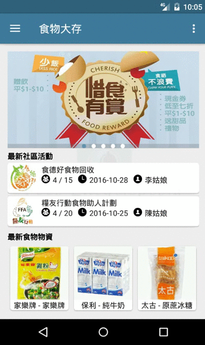
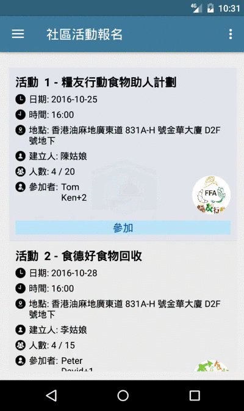
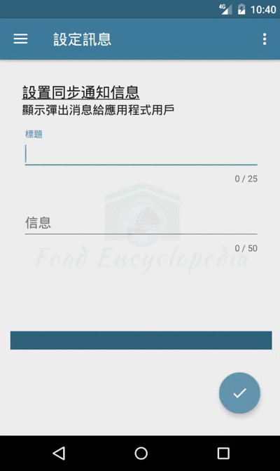
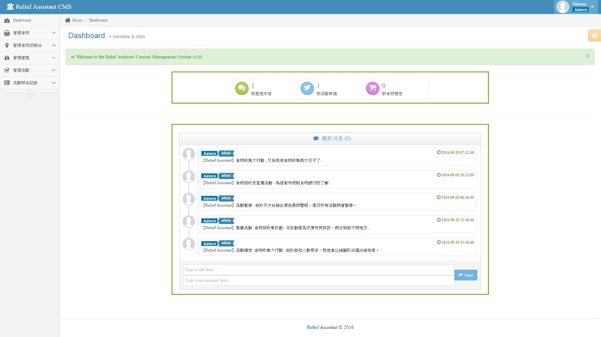

#  FoodEncyclopedia

> **2016 Digital Economy Innovation and Entrepreneurship Competition (Mainland, HK & Macao)**
>
> A cross-platform food bank management ecosystem comprising a native Android application and a centralized CMS, designed to streamline emergency dietary assistance and food distribution for citizens in need.

[](#) &nbsp;
[](#) &nbsp;
[](#) &nbsp;
[](#) &nbsp;
[](#) &nbsp;
[](#) &nbsp;
[](LICENSE)

## Project Vision & Background
**FoodEncyclopedia** was developed to bridge the information gap between food banks and citizens facing economic hardship. By digitizing inventory and distribution data, the system ensures that essential supplies — such as rice, noodles, and milk powder, etc., reach those in need efficiently.

The project addresses three core pillars:
1. **Transparency:** Real-time visibility into dry food inventory.
2. **Accessibility:** Easy location of distribution centers via integrated mapping.
3. **Engagement:** Direct registration for community food events and assistance programs.

## Key Features
### Android Application (User End)
* **Smart Food Enquiries:** Detailed search and filter options for available dry food categories and stock levels.
* **Geolocation Services:** Integrated **Google Maps API** to locate the nearest food distribution stations.
* **Smart Coupons:** QR-code based discount system for redeeming food-related offers.
* **Event Management:** In-app registration for community events and workshops.
* **Instant Notifications:** Real-time push alerts for urgent food distribution updates.
* **Interactive Customer Service:** Integrated support module for user enquiries.

### CMS Portal (Administrator End)
* **Inventory Management:** Centralized database to update food types and stock quantities.
* **Station Coordination:** Manage distribution point information and operating hours.
* **Analytics & Reporting:** Monitor event registrations and aid distribution efficiency.

## Installation & Deployment
### Android App
1. Clone the repository.
2. Open the project in **Android Studio**.
3. Build and run on an emulator or physical device (Minimum SDK: API 19+).

### CMS Website
1. Upload the `/cms` directory to your web server (XAMPP/WAMP/LAMP).
2. Import the provided SQL database file via phpMyAdmin.
3. Configure `config.php` with your database credentials.

> [!TIP]
> **Windows Users:** For local testing of the CMS, ensure Apache and MySQL are active in your XAMPP Control Panel.

## Screenshots
| Home Page     | Event Page    |
| :-------------: | :-------------: |
|  |  |

| Coupon Page     | Notification    |
| :-------------: | :-------------: |
|  |  |

| CMS Website     |
| :-------------: |
|  |

## License
- FoodEncyclopedia is released under the [Apache Version 2.0 License](http://www.apache.org/licenses/LICENSE-2.0.html).
```
Copyright 2016 alvinau0427

Licensed under the Apache License, Version 2.0 (the "License");
you may not use this file except in compliance with the License.
You may obtain a copy of the License at

   http://www.apache.org/licenses/LICENSE-2.0

Unless required by applicable law or agreed to in writing, software
distributed under the License is distributed on an "AS IS" BASIS,
WITHOUT WARRANTIES OR CONDITIONS OF ANY KIND, either express or implied.
See the License for the specific language governing permissions and
limitations under the License.
